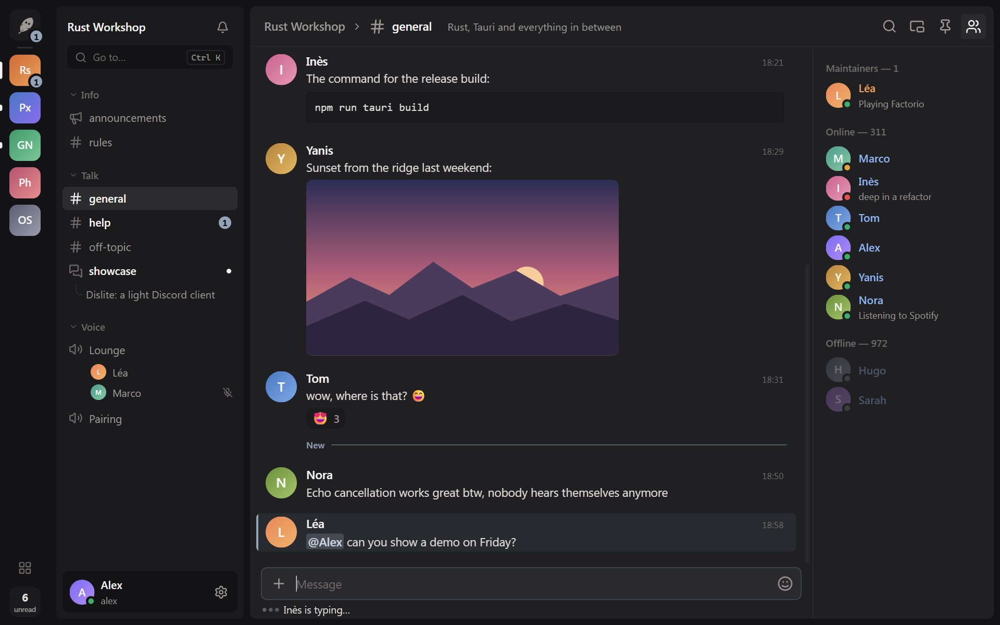
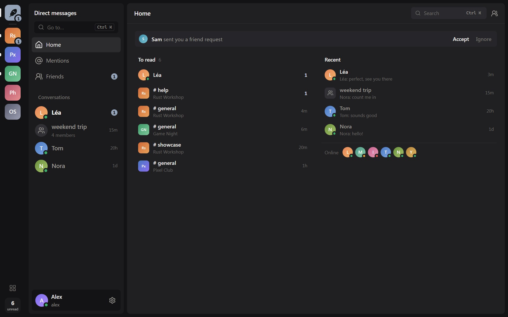
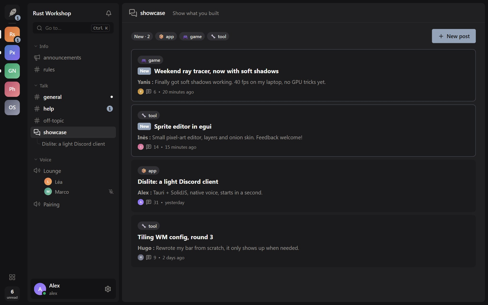
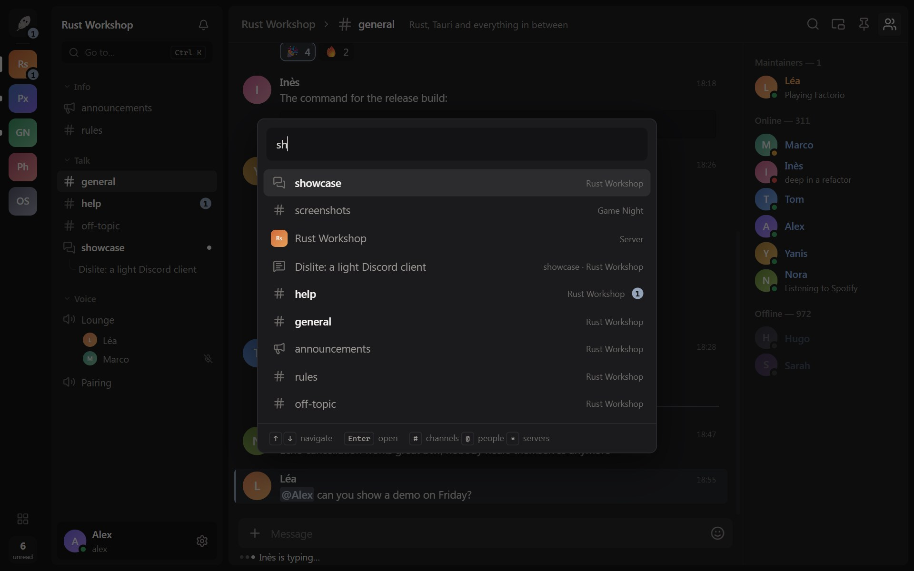
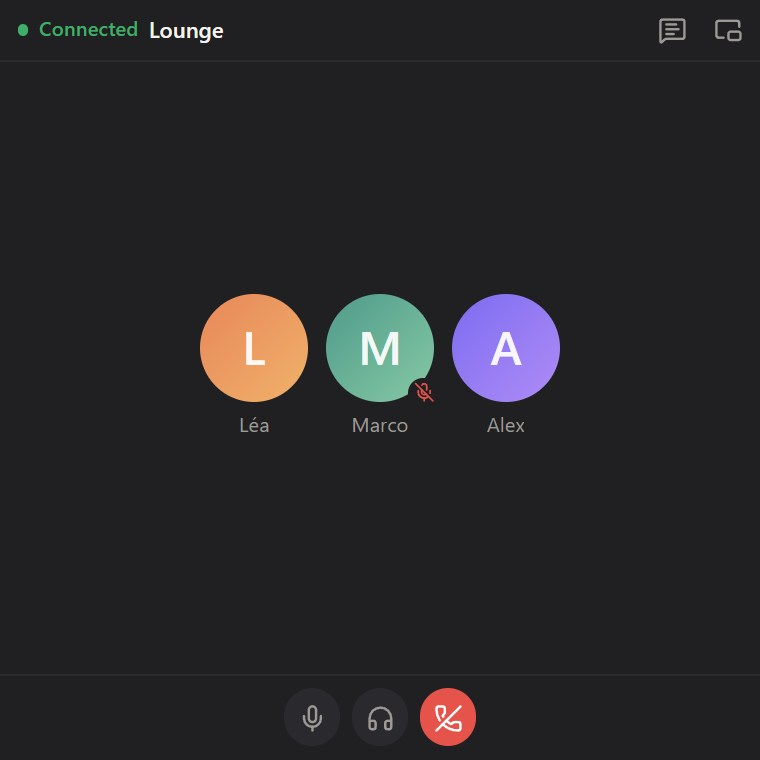
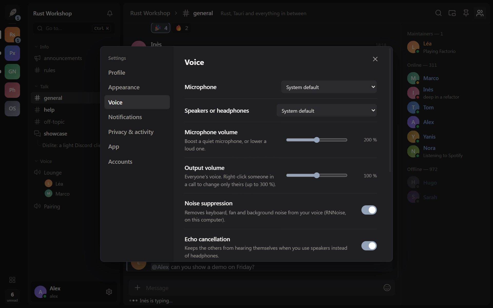
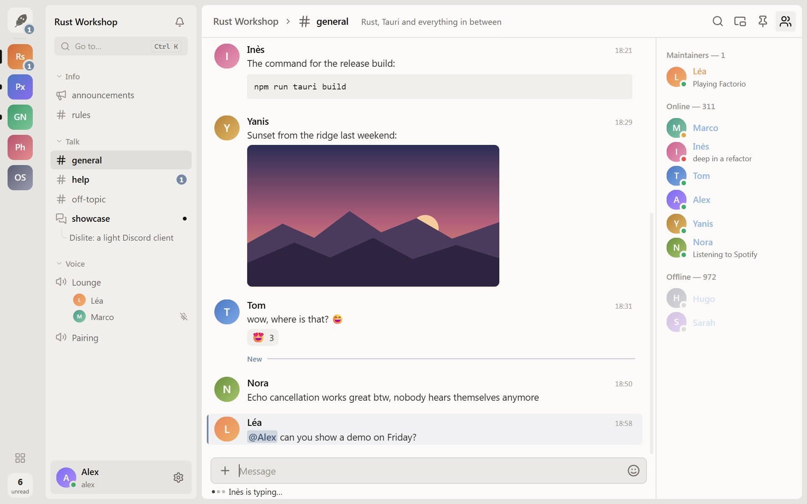

<h1 align="center">

&nbsp;&nbsp;Dislite
</h1>

**A light, calm Discord client for Linux and Windows: native voice, fast start, nothing that pulls you in.**

Dislite talks to Discord directly, without the official app. It opens in a second from a local
snapshot, keeps a quiet look (neutral greys, one accent color for what matters), and is built to
catch up on what's new and get back to your day. Rust (Tauri 2) and SolidJS.



> **Unofficial client.** Third-party clients are against Discord's Terms of Service. Dislite
> behaves like the official web client and automates nothing, but the risk is not zero. Use it
> at your own risk.

## What's inside

<table>
<tr>
<td></td>
<td><b>Home</b><br>What's left to read, recent conversations, friend requests and who's online, on one screen. The <b>unread</b> button at the bottom left opens the next one.</td>
</tr>
<tr>
<td></td>
<td><b>Forums</b><br>Posts created since your last visit get a <b>New</b> badge, new replies are flagged, and both come first. One click on <b>New</b> shows only them.</td>
</tr>
<tr>
<td></td>
<td><b>Quick switcher</b> <code>Ctrl + K</code><br>Any channel, conversation, server or person, from the keyboard. <code>#</code> channels, <code>@</code> people, <code>*</code> servers.</td>
</tr>
<tr>
<td></td>
<td><b>Mini mode</b> <code>Ctrl + Shift + B</code><br>A small window that stays on top: who's in the call, who's talking, mute, deafen, hang up. Or just the chat.</td>
</tr>
<tr>
<td></td>
<td><b>Native voice</b><br>Voice channels and calls with Discord's end-to-end encryption (DAVE). Noise suppression (RNNoise) and echo cancellation (WebRTC AEC3), on your computer.</td>
</tr>
<tr>
<td></td>
<td><b>Light or dark</b><br>Pick the theme, the accent color and the density.</td>
</tr>
</table>

And also:

- **Messages**: replies, edits, reactions, emoji, polls, embeds, files with upload progress, pins,
  search, profiles.
- **Several accounts** on the same computer, sign in with a QR code.
- **Captchas** shown in a small window when Discord asks for one, then the action goes through.
- **Focus mode** (`Ctrl + B`): only the conversation.
- **Hide servers** from the bar and order them your way, without changing anything on Discord.
- **Notifications** with buttons (open, join or decline a call), tray icon, start at login,
  start minimized.
- **Updates** downloaded from the releases, installed when you choose.

What Dislite leaves out on purpose: video and screen sharing, server administration, sending GIFs,
Stage, soundboard and activities.

## Installation

### Windows

Download `Dislite_x.y.z_x64-setup.exe` from the [latest release](https://github.com/git-psi/Dislite/releases/latest)
and run it. No administrator rights needed. Dislite then updates itself.

### Linux

From the [latest release](https://github.com/git-psi/Dislite/releases/latest):
 - **AppImage**: make it executable and run it. It updates itself.
 - **.deb** (Debian, Ubuntu): `sudo apt install ./Dislite_x.y.z_amd64.deb`.
 - **Arch, CachyOS, Manjaro**: `sudo pacman -U ./dislite-x.y.z-1-x86_64.pkg.tar.zst`. Updated through pacman: download the new package for each version (no self-update).

Notifications with buttons, the tray icon and video playback use your desktop's usual libraries
(`libayatana-appindicator`, GStreamer). Without GStreamer, videos open in mpv or your browser.

## Shortcuts

| Keys | Action |
|---|---|
| `Ctrl + K` | quick switcher |
| `Ctrl + F` | search in the channel |
| `Ctrl + G` | all servers |
| `Ctrl + B` | focus mode |
| `Ctrl + Shift + B` | mini mode |
| `Alt + ↑` / `Alt + ↓` | previous / next channel (`Shift`: unread only) |
| `Alt + ←` / `Alt + →`, mouse side buttons | back / forward |
| `Escape` | mark the channel as read and jump to the bottom |

## Building from source

<details>
<summary>Linux (Arch, CachyOS…)</summary>

```sh
sudo pacman -S --needed webkit2gtk-4.1 rustup nodejs npm base-devel opus
rustup default stable
```

</details>

<details>
<summary>Windows</summary>

```powershell
winget install Microsoft.VisualStudio.2022.BuildTools --override "--wait --add Microsoft.VisualStudio.Workload.VCTools --includeRecommended"
winget install Rustlang.Rustup OpenJS.NodeJS.LTS Kitware.CMake
```

WebView2 is already there on Windows 10 and 11.

</details>

```sh
npm install
npm run tauri dev      # development
npm run tauri build    # installer (Windows) or .deb / AppImage (Linux)
```

Your session and settings stay in `~/.config/dev.accord.client/` (Linux) or
`%APPDATA%\dev.accord.client\` (Windows).

<details>
<summary>Code layout</summary>

```
src-tauri/src/
  discord/          REST API, gateway, identity, QR sign-in, captcha
  voice/            voice engine: gateway, UDP, encryption, DAVE, Opus, RNNoise, echo cancellation
  commands.rs       commands called by the interface
  desktop.rs        tray, start at login, start minimized
  updater.rs        updates from the releases
  storage.rs        accounts and settings on disk

src/
  gateway/handlers/ one file per kind of event (messages, servers…)
  store/            state, writes, derived data, interface state
  actions/          what the user does (send, react, navigate…)
  components/       interface
  dev/              debug bridge and demo data (development only)
```

</details>

Linux and Windows share the same code: the few differences are `#[cfg(...)]` blocks on the Rust
side. A change to the interface applies to both.

## Releasing a version

1. Change `version` in `package.json` (Tauri reads it from there).
2. `git tag v0.2.0 && git push --tags`.
3. The *Release* workflow builds Windows and Linux, signs the update packages and creates a draft
   release with `latest.json`. Publish it: installed copies pick it up.

The signing key is the repository secret `TAURI_SIGNING_PRIVATE_KEY`; its public half is in
`src-tauri/tauri.conf.json`.

## License

MIT (`LICENSE`). Not affiliated with Discord.

---

<p align="center">
Made with ❤️ · designed by <a href="https://github.com/git-psi">git-psi</a>, developed with
<a href="https://claude.com/claude-code">Claude</a>
</p>
